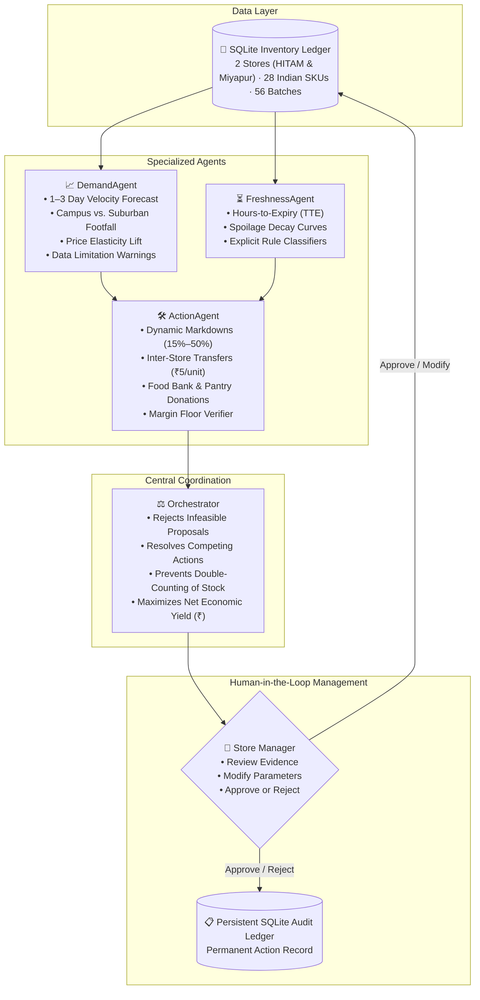

# 🌿 FreshGuard
### Intelligent Perishable Demand & Shelf-Life Management for Zero-Waste Groceries

> **GDGoC HITAM Agentic AI Hackathon** — *Problem Statement 2: "Zero-Waste Grocery — An Agentic AI Approach to Perishable Demand & Shelf-Life Management"*

---

## 🛠️ Framework & Technology Stack

| Component | Technology | Description |
| :--- | :--- | :--- |
| **Backend & REST API** | **Python 3.9+ Standard Library** | Built with `http.server`, `socketserver`, `sqlite3`, `hashlib`, `secrets`, and `urllib`. **Zero mandatory pip dependencies required to run!** |
| **Primary Entrypoint** | [`app.py`](file:///C:/Users/anjuv/.gemini/antigravity-ide/scratch/freshguard/app.py) / [`server.py`](file:///C:/Users/anjuv/.gemini/antigravity-ide/scratch/freshguard/server.py) | Self-bootstraps database, seeds perishable demo inventory, and launches the application on port `8080`. |
| **Frontend UI** | **Vanilla HTML5, CSS3, ES6+ JS** | Bespoke design system (warm ivory, deep forest green, editorial typography), camera barcode scanner, and interactive state management without heavy JS bundles. |
| **Companion Edition** | [`streamlit_app.py`](file:///C:/Users/anjuv/.gemini/antigravity-ide/scratch/freshguard/streamlit_app.py) | Streamlit dashboard for alternative analytical views (`pip install -r requirements.txt`). |
| **Database Engine** | **SQLite 3** | ACID-compliant storage with PBKDF2 salt-hashed credentials, multi-tenant customer isolation, and immutable audit logging. |

---

## 📁 Repository Directory Structure

```
freshguard/
├── agents/                       # Specialized Multi-Agent Decision System
│   ├── __init__.py               # Agent module exports
│   ├── demand_agent.py           # 1–3 Day perishable demand forecasting & elasticity
│   ├── freshness_agent.py        # Real-time shelf-life decay & spillage risk classifier
│   ├── action_agent.py           # Candidate interventions (markdowns, transfers, donations)
│   └── orchestrator.py           # Trade-off optimizer, yield maximizer & stock guardrail
├── static/                       # Frontend Assets & Client Logic
│   ├── index.html                # Single-page web application UI
│   ├── css/app.css               # Editorial design system, animations & responsive styling
│   └── js/app.js                 # Client state, Google OAuth flow, Barcode scanner & CRUD
├── app.py                        # ⭐ MAIN ENTRYPOINT — Auto-bootstraps DB & opens browser
├── server.py                     # HTTP server & customer-authenticated REST API (Port 8080)
├── engine.py                     # Autonomous multi-tier optimization engine & catalog lookups
├── freshguard_db.py              # SQLite schema, PBKDF2 security & seed data generator
├── evaluation_simulator.py       # 7-day comparative simulation (Baseline vs FreshGuard)
├── sample_grocery_stock.csv      # Sample Indian grocery CSV for upload verification
├── requirements.txt              # Dependency manifest (optional Streamlit/dotenv packages)
├── .env.example                  # Environment configuration template (OAuth credentials)
├── .gitignore                    # Excludes virtual environments, caches, secrets & local DBs
├── streamlit_app.py              # Optional Streamlit edition dashboard
└── test_*.py                     # Comprehensive test & verification suites
```

---

## 📌 Problem & Solution Architecture

Commercial grocery stores lose billions in perishable food due to passive, uncoordinated inventory systems. **FreshGuard** replaces passive alerts with a **Specialized Multi-Agent Decision System Coordinated by an Orchestrator**, providing deterministic mathematical optimization, constraint validation, and human-in-the-loop manager approval tailored for everyday Indian groceries and stores.

---

## 🧠 Specialized Agents & Orchestrator Pipeline



### 1. `DemandAgent` ([`agents/demand_agent.py`](file:///C:/Users/anjuv/.gemini/antigravity-ide/scratch/freshguard/agents/demand_agent.py))
- Estimates 1–3 day forward perishable demand using baseline velocity, campus institutional mart vs. suburban family depot profiles, traffic scenario multipliers, and price elasticity.
- Provides step-by-step transparent math.
- Detects and flags data limitations when historical variance is high or stockouts constrain observed velocity.

### 2. `FreshnessAgent` ([`agents/freshness_agent.py`](file:///C:/Users/anjuv/.gemini/antigravity-ide/scratch/freshguard/agents/freshness_agent.py))
- Computes real-time Hours-to-Expiry ($TTE$) across storage zones (*Chilled $2\text{--}4^\circ\text{C}$, Cool Produce $6\text{--}10^\circ\text{C}$, Ambient*).
- Calculates sellable volume before cutoff ($S_{\text{sellable}} = \min(\text{Stock}, D_{\text{rate}} \times \text{Days Left})$) and projected spoilage waste.
- Uses explicit rules to classify risk (`CRITICAL_EXPIRY_RISK`, `MODERATE_EXPIRY_RISK`, `STOCKOUT_RISK`, `OVERSTOCK`, `BALANCED`) with manager-ready explanations in ₹.

### 3. `ActionAgent` ([`agents/action_agent.py`](file:///C:/Users/anjuv/.gemini/antigravity-ide/scratch/freshguard/agents/action_agent.py))
- Evaluates candidate interventions:
  - **Dynamic Markdowns**: Selects optimal discount tier, models price elasticity demand lift, and enforces minimum selling price floors (cost price check in INR).
  - **Inter-Store Transfers**: Checks transit cold-chain feasibility (45-min courier drive), destination absorption capacity, source safety stock preservation, and freight costs (₹5.00/unit).
  - **Zero-Landfill Donations**: Emergency routing to community kitchens for batches within 12h of cutoff.

### 4. `Orchestrator` ([`agents/orchestrator.py`](file:///C:/Users/anjuv/.gemini/antigravity-ide/scratch/freshguard/agents/orchestrator.py))
- Collects candidate proposals, filters out violated constraints, compares net economic yields, and **prevents stock double-allocation by selecting exactly one primary winning action per SKU batch**.

---

## 🥛 Reproducible Benchmark Demo: Fresh Milk Pouch Rebalancing Scenario

FreshGuard includes a benchmark scenario designed for hackathon judges:

| Metric / Parameter | Store 101: HITAM Campus Store (Campus Hub) | Store 102: Miyapur Neighbourhood Store (Family Depot) |
| :--- | :--- | :--- |
| **Initial On-Hand Stock** | 68 pouches (Surplus: 25 pouches) | 14 pouches (Safety Target: 35 pouches) |
| **Daily Sales Velocity** | 19 pouches / day | 42 pouches / day |
| **Shelf Life Remaining** | 2.2 days (54 hours) | 1.2 days (28 hours) |
| **Initial Risk Status** | Moderate Expiry Surplus | **Impending Stockout Threat** |

### Orchestrator Trade-Off Evaluation
1. **Option A (Local Markdown at Store 101)**: Slash price by 20% to accelerate local clearing ➔ Yields **₹600.00** gross (₹24/pouch), but cannibalizes remaining stock and leaves Store 102 stocked out.
2. **Option B (Inter-Store Transfer to Store 102)**: Transfer 25 pouches via 45-min courier (₹125 freight). All 25 pouches sell at full retail (₹30.00) in Miyapur, while Campus Store's remaining 43 pouches sell naturally at full price ➔ Net Yield **+₹825.00** (higher margin + solves neighbourhood family stockout).
3. **Winning Decision Selected**: **Inter-Store Transfer** (`REC-001`).

---

## 👤 Human-in-the-Loop Control (No Black-Box Auto-Changes)

In accordance with enterprise grocery governance:
1. **No Auto-Inventory Alteration**: Generating recommendations does NOT change physical inventory.
2. **Manager Approval**: Managers click **"Approve & Execute"** to confirm and apply actions.
3. **Manager Modification**: Managers click **"Modify"** to adjust discount % or transfer quantity within safe guardrails.
4. **Manager Rejection**: Managers can click **"Reject"** and select an operational override reason (e.g. *Supplier return credit agreed*), recording the event in the audit log without altering stock.

---

## 🧪 Automated Test Suite

Run the comprehensive test suites verifying the entire decision and evaluation system (17/17 tests passing):
```powershell
# 1. Run the specialized multi-agent decision system test suite (7 tests)
python test_decision_system.py

# 2. Run the 7-day reproducible evaluation & benchmark simulation test suite (6 tests)
python test_evaluation_simulator.py

# 3. Run database integrity and API workflow tests (4 tests)
python test_freshguard.py

# 4. Run the end-to-end QA validation script
python verify_all_qa_requirements.py
```

### Test Coverage Summary:
- ✅ **Test 1**: Real-time shelf-life decay and critical expiry rule triggering ($TTE$).
- ✅ **Test 2**: Depleted stock and stockout threat classification.
- ✅ **Test 3**: Valid vs invalid transfers (transit time vs remaining shelf-life guardrails).
- ✅ **Test 4**: Minimum price margin constraints & price elasticity demand lift in INR.
- ✅ **Test 5**: Orchestrator conflict resolution & zero double-allocation guarantee.
- ✅ **Test 6**: Full manager review lifecycle (Approve, Modify, Reject + SQLite Audit Log).
- ✅ **Test 7**: Fresh Milk Pouch benchmark scenario resolution (+37.5% higher net yield for transfer).
- ✅ **Test 8**: Identical starting conditions for Baseline and FreshGuard in 7-day simulation.
- ✅ **Test 9**: Deterministic mathematical repeatability across simulation runs (Seed: 42).
- ✅ **Test 10**: Expiry handling, non-negative inventory, and 0 constraint violations.
- ✅ **Test 11**: Metric calculation integrity (COGS, freight deduction, fulfillment rate).
- ✅ **Test 12**: All 4 simulation scenarios (Normal, Surplus Expiry, Demand Surge, Constrained Transfer).
- ✅ **Test 13**: Strict physical inventory conservation invariant ($\text{Inflow} = \text{Outflow} + \text{Retained}$).

# 5. Run the End-to-End Customer Journey & Isolation Test (9/9 checks)
python test_customer_journey_e2e.py

# 6. Run the 30-Second Judge Simplification Verification Suite (10/10 checks)
python test_hackathon_simplification.py
```

### Complete Test Coverage Matrix:
- ✅ **Customer Journey & Isolation (9 checks)**: Sign up → Login session check → Store onboarding → CSV validation (accept valid, reject invalid) → Stock persistence → Strict data isolation (Customer vs Demo) → Multi-agent execution on customer stock → Human approval & execution → Edit & Delete product lifecycle.
- ✅ **Decision Engine & QA (9 checks)**: Real-time shelf-life decay ($TTE$), stockout threat classification, transfer constraints, price elasticity, orchestrator conflict resolution, human-in-the-loop lifecycle, fresh milk pouch benchmark (+37.5% net yield), and 7-day fair simulation invariant.
- ✅ **30-Second Hackathon Clarity (10 checks)**: Clear purpose banner, 4-step workflow, plain everyday language, KPI metrics, human approval, and INR currency formatting.

---

## 🔐 Customer Access, Authentication & Multi-Tenancy

FreshGuard AI supports secure customer access and multi-tenant store isolation:

### 1. Account Access & Welcome Page
- **Polished Welcome Screen**: Features Log In and Sign Up tabs with clear visual cues and form validation.
- **1-Click Hackathon Demo Mode**: Ready-to-demo accounts (`HITAM Campus Store` and `Miyapur Neighbourhood Store`) allow hackathon judges to immediately test without manual registration.
- **Password Security**: Passwords are **never stored in plain text**. FreshGuard uses standard `PBKDF2-HMAC-SHA256` hashing with individual 16-byte cryptographically secure random salts.
- **Session Tokens**: Authenticated requests use cryptographic bearer tokens stored in the SQLite session table and sent via `Authorization: Bearer <token>` or `X-Auth-Token` headers.
- **Logout & Route Protection**: Unauthenticated requests cannot read or mutate customer-specific inventory or audit logs.

### 2. Streamlit Google Login Integration
When deployed with Streamlit (`streamlit_app.py`), FreshGuard integrates with Streamlit's official authentication mechanism (`st.login()` and `st.experimental_user`):
```toml
# In .streamlit/secrets.toml
[auth]
redirect_uri = "http://localhost:8501/oauth2callback"
cookie_secret = "your-random-32-byte-secret-key"

[auth.google]
client_id = "your-google-oauth-client-id.apps.googleusercontent.com"
client_secret = "GOCSPX-your-google-oauth-client-secret"
server_metadata_url = "https://accounts.google.com/.well-known/openid-configuration"
```
When configured, users can log in via Google with one click, and their store profile is mapped to their verified Google email address.

### 3. First-Time Customer Onboarding Wizard
Upon initial registration or login, new store managers are greeted by an onboarding setup wizard requesting:
- **Store / Business Name** (e.g. *Banjara Gourmet Fresh*)
- **Store Location / City** (e.g. *Hyderabad*)
- **Store Type** (*Supermarket*, *Hyperlocal Kirana*, *Organic Specialty*, *Hypermarket*, *Bakery & Dairy Outlet*)
- **Number of Branches** (1 to 50)
- **Main Categories Handled** (*Vegetables & Fruits*, *Dairy & Eggs*, *Bakery & Sweets*, *Staples & Pantry*)

These details are persistently saved in the SQLite `stores` table, dynamically provisioning an isolated store identifier (e.g. `STORE-CUST-007`).

---

## 📦 Customer Stock Data Management

Store managers manage perishable inventory via the **My Stock** page:
1. **Manual Product Addition**:
   - Fields: Product Name, SKU, Category, Stock on Hand, Expected Daily Sales, Unit Selling Price (₹), Unit Cost (₹), Expiry Date & Time, Supplier/Mandi, Incoming Stock & Delivery Date, Promotion Info.
   - Comprehensive input validation: Rejects negative quantities, negative prices, missing names, and invalid expiry dates.
2. **Spreadsheet / CSV Upload**:
   - Managers upload `.csv` files (Excel export friendly).
   - **Pre-upload Validation Preview**: FreshGuard scans all rows, highlighting valid vs invalid records with explicit line-by-line error messages.
   - **Template Download**: One-click download of [`sample_grocery_stock.csv`](file:///C:/Users/anjuv/.gemini/antigravity-ide/scratch/freshguard/sample_grocery_stock.csv) containing realistic Indian grocery items, INR pricing, and suppliers.
3. **Product Edit & Delete**:
   - In-place modification of pricing, quantities, or suppliers.
   - Soft-delete with audit logging, enforcing ownership so one store manager cannot alter another store's stock.

---

## 🔑 Google OAuth Authentication & First-Time Customer Experience

FreshGuard allows customers to register and authenticate via standard Google OAuth or email/password:
- **"Continue with Google" Button**: Integrated into both Login and Sign-Up modals with official Google branding and CSRF-protected tokens.
- **Google OAuth Setup Guide**: Clicking the setup banner or settings opens the step-by-step Google Cloud Console configuration guide (`client_id`, `client_secret`) saved securely to SQLite.
- **Sandbox Evaluation Mode**: When external Google Cloud credentials are not configured, the system provides one-click sandbox customer profiles (`alex.customer@gmail.com` and `priya.patel@gmail.com`) allowing hackathon judges to experience full multi-tenant isolation without API configuration hurdles.
- **Private Data Partitions**: Each Google or email account receives an isolated `user_id` ensuring customer product lists remain completely private.

---

## 📦 Customer Product Management & Barcode Scanning

Customers are not restricted to administrator-provided stock. They can add, track, view, edit, and delete their own household or store groceries.

### 1. "Add New Product" Workflow
Clicking **Add New Product** in the dashboard or stock page presents two clear options:
1. **Scan Barcode**: Scans the barcode on the product packaging using the device's camera.
2. **Enter Manually**: Opens a comprehensive product entry form.

### 2. Live Barcode Scanner & Catalog Lookup
- **Device Camera Scanner**: Requests camera access via `navigator.mediaDevices.getUserMedia` and scans video frames using the native `BarcodeDetector` API.
- **Supported Formats**: Supports EAN-13, EAN-8, UPC-A, and UPC-E.
- **Automated Catalog Lookup**: Matches scanned codes against FreshGuard's Indian grocery catalog (*Amul, Mother Dairy, Britannia, Nestle, Tata Sampann, Kissan, Epigamia, Fresho, Licious*) with fallback to the Open Food Facts global database.
- **Confirmation Step (No Auto-Save)**: Barcode lookups present a confirmation card showing the barcode, name, brand, and category. Customers review and edit details before saving. Missing required fields are highlighted for manual entry.
- **Manual Barcode Fallback**: If camera access is denied or unavailable, customers can type any barcode manually.
- **Clear Error Feedback**: Displays distinct, informative messages for camera permission denials, invalid formats, and unrecognised barcodes.

### 3. Manual Product Entry Form & Strict Validation
For unbarcoded items or custom inventory, the manual entry form includes 8 structured fields:
- **Product Name** *(Required, non-blank)*
- **Brand** *(Optional)*
- **Category** *(Required: `fruits`, `vegetables`, `dairy`, `meat`, `packaged food`, `beverages`, `other`)*
- **Barcode** *(Optional, validates format and enforces customer-level uniqueness)*
- **Purchase Date** *(Optional)*
- **Expiry Date** *(Optional, validates that expiry date $\ge$ purchase date)*
- **Storage Instructions** *(Optional)*
- **Notes** *(Optional)*

**Validation Rules & Safety**:
- Rejects missing product names or invalid categories.
- Prevents duplicate barcodes within the same customer's list (different customers can have identical barcodes in their private accounts).
- Enforces `expiry_date >= purchase_date`.
- Preserves all entered form inputs upon validation failure so users never lose their data.
- Disables double submission with loading spinners and provides clear success banners.

### 4. View, Edit, and Delete Lifecycle
- **View Modal**: Clicking **View** displays full product specifications, category badge, barcode badge, storage instructions, and notes.
- **Edit Modal**: Clicking **Edit** pre-fills the form with existing values. Allows updating product details while retaining the existing barcode without triggering duplicate-barcode errors.
- **Delete with Confirmation**: Clicking **Delete** prompts an explicit confirmation modal with product name verification and destructive warnings. Products are removed only after server confirmation.
- **Customer Privacy**: All read, edit, and delete API endpoints enforce ownership verification; requests from another account return `403/404` errors.

---

## 🤖 Multi-Agent Decision Engine on Customer Data

The specialized agents run directly against the logged-in customer's active inventory:
- **Demand Agent**: Computes 1–3 day sales projections. **Transparent Fallback**: When sales history is new or insufficient (`avg_daily_sales <= 0`), the agent transparently falls back to category velocity benchmarks (*Dairy: 12.0/day, Bakery: 14.0/day, Vegetables: 15.0/day, Fruits: 10.0/day*) with a conservative confidence rating and plain-English explanation.
- **Freshness Agent**: Calculates remaining shelf-life hours, flags items at risk of expiring before normal sales velocity can clear them, and computes financial exposure in INR.
- **Action Agent & Orchestrator**: Proposes dynamic markdowns (15%–50%), inter-store transfers, or supplier holds. Estimates expected financial yield (₹) and waste avoided (kg), explicitly labeled as projections.

---

## 🛡️ Multi-Tenant Data Isolation & Persistence

- **SQLite Persistent Database** ([`freshguard.db`](file:///C:/Users/anjuv/.gemini/antigravity-ide/scratch/freshguard/freshguard.db)): Stores users, stores, inventory batches, customer products, settings, and audit logs.
- **Scoped Queries**: All customer product retrieval, additions, updates, and deletions filter strictly by `user_id`.
- **Demo Dataset Separation**: The seeded demo stores (`STORE-101`, `STORE-102`) remain available for benchmark evaluation and judges without mingling with real customer accounts.
- **Persistent Audit Log**: Every approved or rejected recommendation is permanently recorded in `rescue_actions` and `system_logs` with timestamp, user ID, SKU, action type, and operational override notes.

---

## 🚀 Quickstart & Setup Guide

### 1. Prerequisites
- **Python 3.9+** (Standard installation)
- Modern web browser (Chrome, Edge, Firefox, Safari)
- Camera access (optional, for live barcode scanning)

### 2. Environment Configuration (Optional)
FreshGuard is pre-configured for instant zero-config launch with built-in Sandbox Demo accounts. If you want to use real Google OAuth:
```powershell
# Copy environment configuration template
Copy-Item .env.example .env

# Edit .env to add your GOOGLE_CLIENT_ID and GOOGLE_CLIENT_SECRET
```

### 3. One-Click Launch (Recommended)
Launch the full FreshGuard AI web application with automatic database bootstrapping, demo seed population, and default browser launch:
```powershell
python app.py
```
*Or run directly on a custom port:*
```powershell
python server.py 8080
```
Open **http://localhost:8080** in your browser.

### 4. Optional Streamlit Companion Edition
If you wish to explore the secondary Streamlit dashboard:
```powershell
pip install -r requirements.txt
streamlit run streamlit_app.py
```

### 5. Run Verification & Test Suites
Execute the automated test suites covering all agent decisions, customer CRUD, barcode scanner, and multi-tenant security:
```powershell
# Full customer products, Google OAuth & barcode E2E test suite (All 5 user requirements)
python test_e2e_customer_products_full.py

# End-to-end customer journey & multi-tenant isolation
python test_customer_journey_e2e.py

# QA Judge technical requirements & decision benchmark
python verify_all_qa_requirements.py

# Hackathon 30-second clarity & UI suite
python test_hackathon_simplification.py
```

---

## 🌐 Cloud Deployment Guide

FreshGuard AI is fully containerized and pre-configured for free cloud hosting platforms:

### Option A: Render (Full Web App + REST API) — Recommended
1. Sign in to [Render](https://render.com) and click **New + > Web Service**.
2. Connect your GitHub repository: `https://github.com/anjuvaishnavi10-cmd/freshguard-ai`.
3. Render automatically detects the configuration from [`render.yaml`](file:///C:/Users/anjuv/.gemini/antigravity-ide/scratch/freshguard/render.yaml):
   - **Environment**: `Python` (or `Docker`)
   - **Build Command**: `pip install -r requirements.txt || true`
   - **Start Command**: `python server.py`
4. Click **Create Web Service**. Your app will be live at `https://freshguard-ai.onrender.com`!

### Option B: Streamlit Community Cloud (Companion Dashboard)
1. Visit [share.streamlit.io](https://share.streamlit.io).
2. Connect your GitHub account and select repository `anjuvaishnavi10-cmd/freshguard-ai`.
3. Set **Main file path** to `streamlit_app.py`.
4. Click **Deploy**. Your analytical dashboard will be live in 60 seconds!

### Option C: Docker Container (Railway / Koyeb / Fly.io / GCP Cloud Run)
Run locally or deploy on any container cloud provider using the included [`Dockerfile`](file:///C:/Users/anjuv/.gemini/antigravity-ide/scratch/freshguard/Dockerfile):
```bash
docker build -t freshguard-ai .
docker run -p 8080:8080 freshguard-ai
```

---

*FreshGuard AI — GDGoC HITAM Agentic AI Hackathon (Problem Statement 2: Zero-Waste Grocery)*


